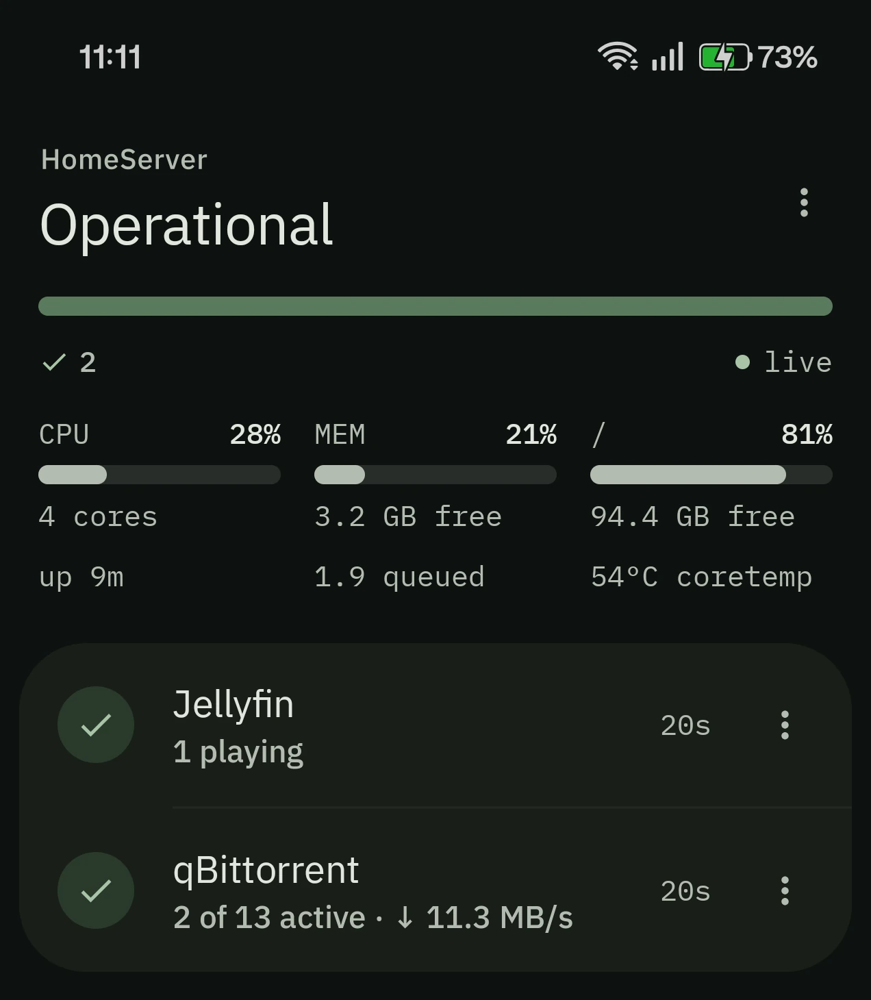

# CueSeek

**Is everything on your home server fine?** One glance at your phone or your watch tells you —
and lets you fix it when it isn't.

**[Website](https://cueseek.vercel.app)** · **[Try the demo](https://cueseek.vercel.app/demo)** ·
**[Download v0.1.4](https://github.com/Kushal-MR/CueSeek/releases/tag/v0.1.4)**

<p align="center">
  
</p>

A small agent on your server checks every service, and the server itself; your phone and
watch get one answer — **Operational**, or what needs you — and can restart a service or the
whole machine.

- **Jellyfin and qBittorrent in full:** health from their own APIs, plus what is playing and
  what is moving.
- **Anything else run as a systemd unit** — Plex, Sonarr, Immich and the rest: whether it is
  running, and start, stop, restart.
- **Never root, never on the open internet.** The agent runs as an ordinary user, and one
  short [polkit rule](deploy/10-cueseek.rules) is everything it may do. You reach it over
  Tailscale, WireGuard or your LAN.

## Install

On Linux (amd64) with systemd and polkit 0.106 or later, from the
[release page](https://github.com/Kushal-MR/CueSeek/releases/latest):

```bash
sha256sum -c SHA256SUMS
tar xzf cueseek-agent_*_linux_amd64.tar.gz && cd cueseek-agent_*_linux_amd64
sudo ./install.sh                                # installs; does not start it
sudo nano /etc/cueseek/config.yaml               # bind.address: an IP your phone can reach
sudo systemctl enable --now cueseekd.service
sudo -u cueseek cueseekd pair                    # a one-time code for the phone
```

Then install `cueseek_*.apk` (Android 8+) and type in the server's address and the code. The
Wear OS app is optional and installs over ADB. The full walkthrough, with adding your
services, is in [docs/install.md](docs/install.md).

## More

- [Architecture](docs/architecture.md) — how it fits together and what works today
- [Decisions](docs/adr/) — every significant decision, with what it cost. Start here if you
  are reading the code.
- [Configuration](docs/configure.md) · [Pairing](docs/pairing.md) ·
  [Troubleshooting](docs/troubleshooting.md) · [Security](SECURITY.md) ·
  [Roadmap](docs/roadmap.md)

## Licence

[Apache 2.0](LICENSE). The bundled IBM Plex fonts are under the SIL Open Font License 1.1;
see [NOTICE](NOTICE).
