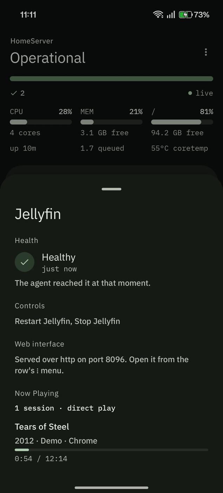
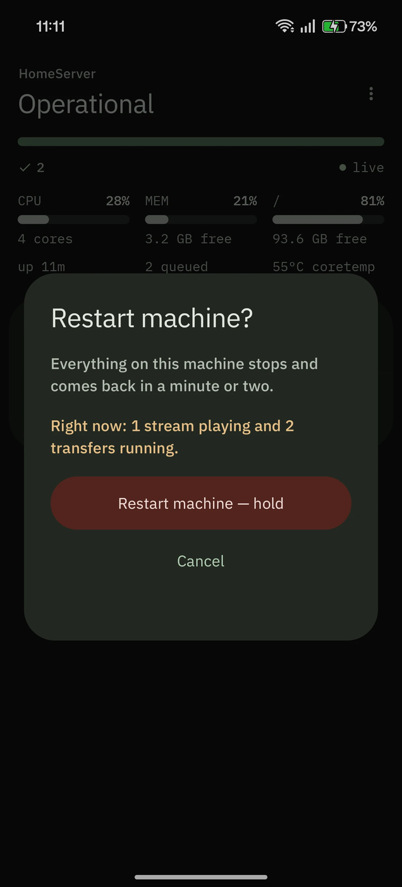
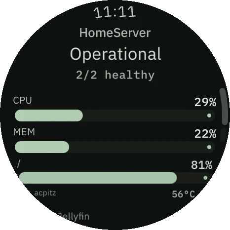

# CueSeek

**An operations console for self-hosted home servers**

**[Website](https://cueseek.vercel.app)** · **[Try the demo](https://cueseek.vercel.app/demo)** ·
**[Download v0.1.4](https://github.com/Kushal-MR/CueSeek/releases/tag/v0.1.4)**

<p align="center">
  
</p>

CueSeek tells you whether everything on your home server is working, on your phone and on
your watch, and lets you fix it when it isn't. A small agent on the server checks each
service and the machine itself; the phone and watch show a single status, **Operational**, or
which services need attention and why.

## What you get

| | |
| --- | --- |
| **Phone** (Android 8+) | A live dashboard: the verdict, CPU, memory, disk and temperature, and every service with what it is doing. Restart or stop a service, reboot or shut down the machine. |
| **Watch** (Wear OS 3+) | The same verdict on your wrist, a tile and a watch-face complication. It pairs with the server itself and has its own permissions. |
| **Agent** (Linux) | One Go binary, run by systemd as an ordinary user. It talks to Jellyfin and qBittorrent through their APIs, and to systemd and logind over D-Bus. |

<p align="center">
  
  &nbsp;
  
  &nbsp;
  
</p>

**What it works with:** Jellyfin and qBittorrent in full, with health from their own APIs plus
what is playing and what is downloading. Any other service run as a systemd unit (Plex,
Sonarr, Immich, Syncthing and so on) gets whether it is running, and start, stop and restart.
Full Plex support is planned.

## How it works

```
   phone        watch
     │            │
     └─────┬──────┘
           │  Tailscale, WireGuard or your LAN
           ▼
   ┌───────────────┐
   │   cueseekd    │   one Go binary, never root
   └───────┬───────┘
           │
     ┌─────┴──────────────────┐
     ▼                        ▼
   Jellyfin, qBittorrent    systemd, logind
   their HTTP APIs          D-Bus, via one polkit rule
```

- The agent runs as an unprivileged user. A [polkit rule](deploy/10-cueseek.rules) lists the
  units it may start, stop and restart, plus reboot and power off, and it can do nothing else.
  ([ADR-0002](docs/adr/0002-host-privilege-dbus-polkit.md))
- You reach it over your private network (Tailscale, WireGuard or your LAN). It is not meant
  to be exposed to the internet. ([ADR-0001](docs/adr/0001-vpn-only-remote-access.md))
- Actions are requests. The app sends a restart, then waits for the server to report how it
  went before showing it. Restarting asks for confirmation; stopping a service or powering
  off needs a press-and-hold. ([ADR-0004](docs/adr/0004-contract-openapi-sse.md),
  [ADR-0005](docs/adr/0005-capability-based-adapters.md))
- Each device is paired with its own token and permissions. By default the watch can restart
  services but cannot power off the server.
  ([ADR-0006](docs/adr/0006-device-pairing-scoped-tokens.md),
  [ADR-0014](docs/adr/0014-watch-pairing-address-handoff.md))

## Install

On Linux (amd64) with systemd and polkit 0.106 or later, from the
[release page](https://github.com/Kushal-MR/CueSeek/releases/latest):

```bash
sha256sum -c SHA256SUMS
tar xzf cueseek-agent_*_linux_amd64.tar.gz && cd cueseek-agent_*_linux_amd64
sudo ./install.sh                                # installs; does not start it
sudo nano /etc/cueseek/config.yaml               # bind.address: an IP your phone can reach
sudo systemctl enable --now cueseekd.service
sudo -u cueseek cueseekd pair                    # a one-time code for the phone
```

Then install `cueseek_*.apk` and type in the server's address and the code. The Wear OS app
is optional and installs over ADB. The full walkthrough, including adding your services, is
in [docs/install.md](docs/install.md).

## Status

`v0.1.4`. Developed and tested on a real home server: an HP laptop running Linux Mint 22.3
(systemd 255, polkit 124) over Tailscale, with a OnePlus phone and a OnePlus Watch 2R, and
installed from scratch on a fresh VM that had never seen it. `linux/amd64` only. Each
milestone has a record of what was verified on that hardware; see the
[roadmap](docs/roadmap.md).

## More

- [Architecture](docs/architecture.md): how it fits together and what works today
- [Decisions](docs/adr/): every significant decision, with what it cost. Start here if you
  are reading the code.
- [Configuration](docs/configure.md) · [Pairing](docs/pairing.md) ·
  [Troubleshooting](docs/troubleshooting.md) · [Security](SECURITY.md)

## Licence

[Apache 2.0](LICENSE). The bundled IBM Plex fonts are under the SIL Open Font License 1.1;
see [NOTICE](NOTICE).
